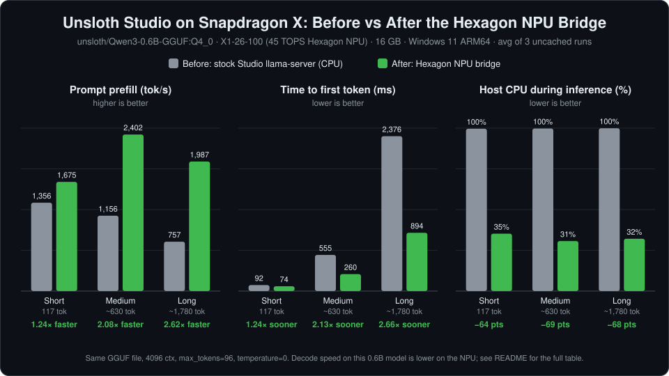
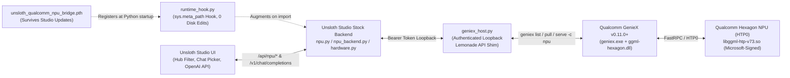

# Unsloth Studio — Qualcomm Hexagon NPU Bridge (Windows on Snapdragon)

Brings **Qualcomm Hexagon NPU (`HTP0`)** acceleration to **Unsloth Studio** on Windows 11 ARM64 Copilot+ PCs (`Snapdragon X`, `Snapdragon X Plus`, `Snapdragon X Elite`), mirroring Unsloth Studio's AMD Ryzen AI XDNA 2 NPU architecture.

> **Upstream Pull Request:** [`unslothai/unsloth#19316`](https://github.com/unslothai/unsloth/pull/19316)

---

## Benchmarks: Before vs After (Qualcomm Hexagon NPU Bridge)

Measured on a **Snapdragon X (`X1-26-100`, 45 TOPS Qualcomm Hexagon NPU, 16 GB LPDDR5x, Windows 11 ARM64 Build 26300)** running **`unsloth/Qwen3-0.6B-GGUF:Q4_0`** (same GGUF file, `4096` context, `max_tokens=96`, `temperature=0.0`, averaged over 3 uncached runs):



| Prompt Length | Before: Prefill (`llama-server` CPU) | After: Prefill (Hexagon NPU) | Before: TTFT | After: TTFT | Before: Host CPU | After: Host CPU | Before: Decode (CPU) | After: Decode (Hexagon NPU) |
| :--- | :---: | :---: | :---: | :---: | :---: | :---: | :---: | :---: |
| **Short (`~117 tok`)** | 1,356.4 tok/s | **1,674.7 tok/s** (`1.23×`) | 92 ms | **74 ms** (`1.24×` faster) | 99.6% | **35.2%** (`-64.4 pp`) | 127.9 tok/s | 72.4 tok/s |
| **Medium (`~630 tok`)** | 1,156.1 tok/s | **2,401.8 tok/s** (`2.08×`) | 555 ms | **260 ms** (`2.13×` faster) | 99.8% | **30.7%** (`-69.1 pp`) | 83.0 tok/s | 48.6 tok/s |
| **Long (`~1,780 tok`)** | 757.0 tok/s | **1,987.1 tok/s** (`2.62×`) | 2,376 ms | **894 ms** (`2.66×` faster) | 99.9% | **32.1%** (`-67.8 pp`) | 44.8 tok/s | 31.9 tok/s |

> **Why is 0.6B decode faster on CPU while prefill/TTFT & host CPU win big on NPU?**  
> On tiny `0.6B` weights (`~382 MB`), CPU decode is L2/SLC cache-resident and avoids DSP/HTP RPC synchronization overhead per token, whereas compute-bound prompt ingestion scales strongly on the Hexagon tensor cores (`2.08×–2.62×` faster prefill and `2.66×` lower Time-To-First-Token at `~1,780` tokens) while freeing **~68 percentage points of host CPU** so your laptop stays responsive and cool.

---

## Highlights

- **Update-Proof Zero-Modification `.pth` Runtime Shim:** Installs a single tiny `unsloth_qualcomm_npu_bridge.pth` hook in `Lib\site-packages\` pointing to `~/.unsloth/qualcomm-npu-bridge/runtime_hook.py` (`sys.meta_path` import interceptor). All Unsloth Studio source files stay **100% stock on disk**, so in-place Studio updates (`uv pip install --upgrade unsloth`) **never overwrite or break the shim**. If upstream PR [`unslothai/unsloth#19316`](https://github.com/unslothai/unsloth/pull/19316) is merged in a future release, the hook automatically steps aside as a no-op.
- **No Windows `TESTSIGNING` Mode Required:** Uses **Qualcomm GenieX CLI (`Qualcomm.GenieX.CLI`)** which ships **Microsoft-signed** Windows ARM64 Hexagon HTP catalogs (`ggml-hexagon.dll` + `libggml-htp-v73.so` + `libggml-htp.cat`). Secure Boot, BitLocker, Smart App Control, and anti-cheat remain untouched.
- **Native Unsloth `Q4_0` GGUF Support:** Runs official `unsloth/*-GGUF:Q4_0` models from Hugging Face on Hexagon `HTP0` with dynamic `--nctx` support, automatic RAM management (unloading `llama-server` on 16 GB devices), tool calling, and reasoning controls.
- **Live NPU Utilization Monitoring:** Wires Windows `DEVPKEY_GPU_LUID` (`cfgmgr32.dll`) + `pdh.dll` GPU Engine counters into Unsloth Studio's `npu_load_percent()` monitor in `<1 ms` with zero PowerShell subprocess overhead.
- **Cleanly Reversible:** Remove anytime via `--revert` or by deleting `unsloth_qualcomm_npu_bridge.pth`.

---

## Architecture



---

## Quick Start (Windows 11 ARM64 / Snapdragon X)

### Prerequisites
- A Windows 11 ARM64 PC with a **Qualcomm Snapdragon X / X Plus / X Elite** processor and **Qualcomm Hexagon NPU**.
- **Unsloth Studio (Desktop)** installed (`%USERPROFILE%\.unsloth\studio`).

### Install

Run in PowerShell:

```powershell
.\install.ps1
```

Or manually:

```powershell
# 1. Install Qualcomm GenieX CLI (Microsoft-signed Hexagon HTP runtime)
winget install --id Qualcomm.GenieX.CLI --exact --accept-package-agreements --accept-source-agreements

# 2. Install the update-proof .pth runtime shim & sync files to %USERPROFILE%\.unsloth\qualcomm-npu-bridge
& "$env:USERPROFILE\.unsloth\studio\unsloth_studio\Scripts\python.exe" .\apply_patch.py --apply

# 3. (Optional) Run the end-to-end verification test suite
& "$env:USERPROFILE\.unsloth\studio\unsloth_studio\Scripts\python.exe" .\test_bridge.py
```

Restart **Unsloth Studio** (quit completely from the system tray and reopen).

---

## Where to Find NPU in Unsloth Studio's UI

Unsloth Studio surfaces NPU controls inside existing views (rather than a separate sidebar tab):

1. **Model Hub (`Hub`) → Format Filter Dropdown → `NPU`:** Next to `Recommended`, `GGUF`, `Safetensors`, `MLX`, and `Fine-tune ready`, select **`NPU`** to enable the runtime and download curated Hexagon NPU models (`unsloth/Qwen3-0.6B-NPU`, `Llama-3.2`, `gemma-3`, etc.).
2. **Chat → Model Picker → `NPU` Filter Pill / Section:** Click the model selector in the Chat composer, choose the **`NPU`** format pill (`All | GGUF | MLX | Safetensors | NPU`) or scroll to the **`NPU`** section, and pick your downloaded model.
3. **Chat Settings & Hardware Monitor:** When an NPU model is active, Chat Settings exposes **Power Mode** (`Power saver` / `Balanced` / `Performance` / `Turbo`), and the Hardware Monitor shows live **Qualcomm Hexagon NPU** utilization.

---

## Customizing the NPU Model Catalog

Edit `%USERPROFILE%\.unsloth\qualcomm-npu-bridge\models.json` to add any Hugging Face `<org>/<repo>:Q4_0` GGUF repository:

```json
{
  "checkpoint": "unsloth/Qwen3-4B-GGUF:Q4_0",
  "hf_repo": "unsloth/Qwen3-4B-NPU",
  "size_gb": 2.38,
  "max_context_window": 32768,
  "labels": ["chat", "reasoning", "tool-calling"]
}
```

Any model you pull directly via `geniex pull <repo>:Q4_0` in the terminal is also automatically discovered and listed in Unsloth Studio's NPU catalog.

---

## Maintenance & Reverting

- **Check shim status & verify Studio files are clean stock:**
  ```powershell
  & "$env:USERPROFILE\.unsloth\studio\unsloth_studio\Scripts\python.exe" "$env:USERPROFILE\.unsloth\qualcomm-npu-bridge\apply_patch.py" --status
  ```
- **Temporarily disable for a single session without removing:** Set `UNSLOTH_QUALCOMM_NPU_DISABLE=1` in the environment.
- **Reinstall if you recreate the Unsloth Studio virtualenv from scratch:**
  ```powershell
  & "$env:USERPROFILE\.unsloth\studio\unsloth_studio\Scripts\python.exe" "$env:USERPROFILE\.unsloth\qualcomm-npu-bridge\apply_patch.py" --apply
  ```
- **Remove the shim cleanly (or delete `Lib\site-packages\unsloth_qualcomm_npu_bridge.pth`):**
  ```powershell
  & "$env:USERPROFILE\.unsloth\studio\unsloth_studio\Scripts\python.exe" "$env:USERPROFILE\.unsloth\qualcomm-npu-bridge\apply_patch.py" --revert
  ```

## License

AGPL-3.0-only (matching Unsloth Studio).
