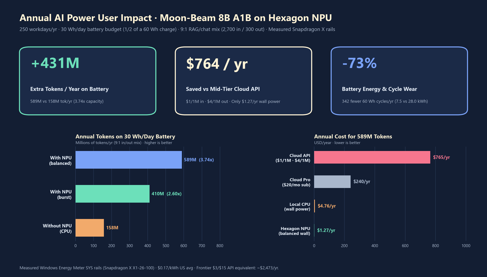
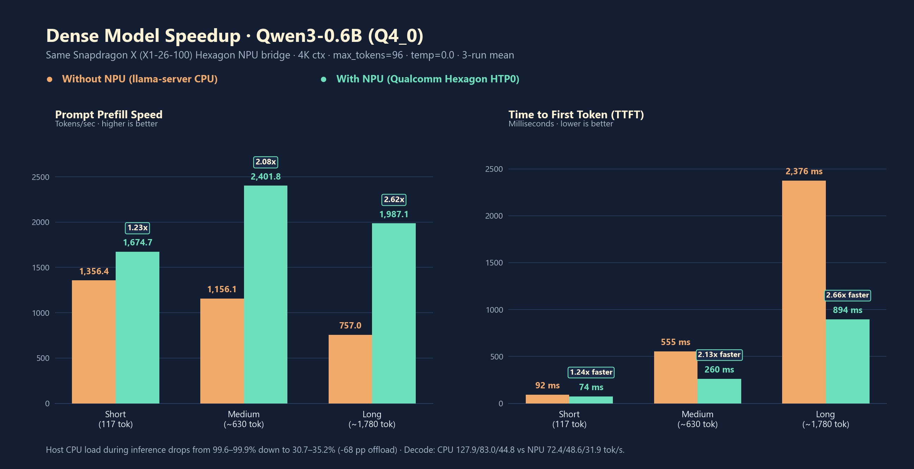
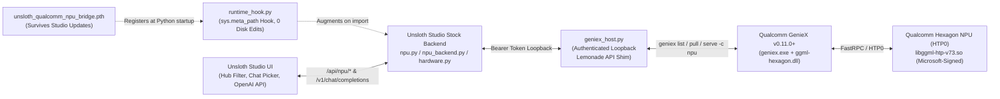

# Unsloth Studio — Qualcomm Hexagon NPU Bridge (Windows on Snapdragon)

Brings **Qualcomm Hexagon NPU (`HTP0`)** acceleration to **Unsloth Studio** on Windows 11 ARM64 Copilot+ PCs (`Snapdragon X`, `Snapdragon X Plus`, `Snapdragon X Elite`), mirroring Unsloth Studio's AMD Ryzen AI XDNA 2 NPU architecture.

> **Upstream Pull Request:** [`unslothai/unsloth#19316`](https://github.com/unslothai/unsloth/pull/19316) · **Flagship NPU Model Release:** [`tablinum/Moon-Beam-8B-A1B-NPU`](https://huggingface.co/tablinum/Moon-Beam-8B-A1B-NPU)



<details>
<summary>Annual Power-User Savings Breakdown (250 workdays/yr · 30 Wh/day battery budget · Measured Snapdragon X rails)</summary>

Assumes an AI power user spending **half a 60 Wh battery charge per workday (`30 Wh/day` × `250 workdays` = `7.50 kWh/yr`)** with a **9:1 RAG/coding/chat token mix (`2,700` input / `300` output)** on **`tablinum/Moon-Beam-8B-A1B-NPU:Q4_0`** (`4.71 GB`):

| Backend / Mode | Annual Tokens (`30 Wh/day`) | Multiplier vs CPU | Energy for Equal `589M` Tokens | Wall Power (`$0.17/kWh`) | Cloud Equivalent (`529.9M` in / `58.9M` out) |
| :--- | :---: | :---: | :---: | :---: | :--- |
| **Without NPU (CPU)** | `158M` | `1.00×` | `28.03 kWh` (`467` cycles) | `$4.76 / yr` | — |
| **With NPU (`burst`)** | `410M` | `2.60×` | `10.78 kWh` (`180` cycles) | `$1.83 / yr` | — |
| **With NPU (`balanced`)** | **`589M`** (**`+431M`**) | **`3.74×`** | **`7.50 kWh`** (**`-73.2%` · `342` fewer cycles**) | **`$1.27 / yr`** | Saves **`$239/yr`** vs `$20/mo` Pro · **`$764/yr`** vs `$1/$4` API · **`$2,472/yr`** vs `$3/$15` frontier API |

</details>

---

## Benchmarks: Before vs After (Qualcomm Hexagon NPU Bridge)

### Dense Model (`unsloth/Qwen3-0.6B-GGUF:Q4_0`)

Measured on a **Snapdragon X (`X1-26-100`, 45 TOPS Qualcomm Hexagon NPU, 16 GB LPDDR5x, Windows 11 ARM64 Build 26300)** running **`unsloth/Qwen3-0.6B-GGUF:Q4_0`** (same GGUF file, `4096` context, `max_tokens=96`, `temperature=0.0`, averaged over 3 uncached runs):




| Prompt Length | Before: Prefill (`llama-server` CPU) | After: Prefill (Hexagon NPU) | Before: TTFT | After: TTFT | Before: Host CPU | After: Host CPU | Before: Decode (CPU) | After: Decode (Hexagon NPU) |
| :--- | :---: | :---: | :---: | :---: | :---: | :---: | :---: | :---: |
| **Short (`~117 tok`)** | 1,356.4 tok/s | **1,674.7 tok/s** (`1.23×`) | 92 ms | **74 ms** (`1.24×` faster) | 99.6% | **35.2%** (`-64.4 pp`) | 127.9 tok/s | 72.4 tok/s |
| **Medium (`~630 tok`)** | 1,156.1 tok/s | **2,401.8 tok/s** (`2.08×`) | 555 ms | **260 ms** (`2.13×` faster) | 99.8% | **30.7%** (`-69.1 pp`) | 83.0 tok/s | 48.6 tok/s |
| **Long (`~1,780 tok`)** | 757.0 tok/s | **1,987.1 tok/s** (`2.62×`) | 2,376 ms | **894 ms** (`2.66×` faster) | 99.9% | **32.1%** (`-67.8 pp`) | 44.8 tok/s | 31.9 tok/s |

> **Why is 0.6B decode faster on CPU while prefill/TTFT & host CPU win big on NPU?**  
> On tiny `0.6B` weights (`~382 MB`), CPU decode is L2/SLC cache-resident and avoids DSP/HTP RPC synchronization overhead per token, whereas compute-bound prompt ingestion scales strongly on the Hexagon tensor cores (`2.08×–2.62×` faster prefill and `2.66×` lower Time-To-First-Token at `~1,780` tokens) while freeing **~68 percentage points of host CPU** so your laptop stays responsive and cool.

### 8B MoE Model ([`tablinum/Moon-Beam-8B-A1B-NPU`](https://huggingface.co/tablinum/Moon-Beam-8B-A1B-NPU) · `Q4_0`, 8B Total / 1B Active)

Measured on the same **Snapdragon X (`X1-26-100`, 16 GB)** running **`Moon-Beam-8B-A1B-Q4_0.gguf`** (`4.71 GB` converted cleanly with `convert_to_hexagon.py --quant Q4_0`) across speed, host CPU offload, and live Windows `\Energy Meter(SYS)` + `CPU_CLUSTER_0/1` power rails (`60 Wh` design / `58.77 Wh` full-charge battery):


<details>
<summary>Read Moon-Beam 8B A1B power & 60 Wh tokens-per-charge measurements as text (2,711-tok prefill / 320-tok decode)</summary>

| Mode | Prefill Speed & Power | Prefill / `60 Wh` Charge | Decode Speed & Power | Decode / `60 Wh` Charge | Continuous Runtime |
| :--- | :---: | :---: | :---: | :---: | :---: |
| **Idle Baseline** | — | — | `3.71 W` (`0.45 W` CPU) | — | `16.17 hrs` |
| **Without NPU (CPU)** | `222.8 tok/s` @ `31.81 W` (`20.46 W` CPU) | `1.51M` | `56.1 tok/s` @ `24.07 W` (`12.77 W` CPU) | `503.6k` | `1.89h` prefill · `2.49h` decode |
| **With NPU (`burst`)** | **`290.2 tok/s`** @ `10.39 W` (`3.02 W` CPU) | `6.03M` (**`3.99×`**) | `27.8 tok/s` @ `9.36 W` (`1.84 W` CPU) | `641.4k` (**`+27%`**) | `5.78h` prefill · `6.41h` decode |
| **With NPU (`balanced`)** | `276.9 tok/s` @ **`5.96 W`** (`0.43 W` CPU) | **`10.02M`** (**`6.63×`**) | `25.1 tok/s` @ **`6.65 W`** (`0.42 W` CPU) | **`816.1k`** (**`+62%`**) | **`10.06h`** prefill · **`9.02h`** decode |

</details>


<details>
<summary>Read the annual battery-cycle &amp; pegged-CPU time breakdown (9:1 continuous battery throughput)</summary>

| Continuous Battery Scenario (`60 Wh` pack, 9:1 mix) | NPU (`balanced`) Output | CPU Output (Same Charges) | NPU Token Gain | Extra 60 Wh Charges CPU Needs for That Gain | Extra Pegged-CPU Time (`~99%` CPU / `18.1 W`) |
| :--- | :---: | :---: | :---: | :---: | :---: |
| **1/2 Charge / Workday** (`125` charges/yr) | `588.8M` tok | `157.5M` tok | `+431.2M` tok | **`+342` extra charges** (`467` total) | **`+697` hrs/yr** (`952h` total · `~87` extra `8h` days) |
| **1 Charge / Workday** (`250` charges/yr) | `1.18B` tok | `315.1M` tok | `+862.4M` tok | **`+684` extra charges** (`934` total) | **`+1,394` hrs/yr** (`1,904h` total · `~174` extra `8h` days) |
| **24/7/365 Continuous** (`8,760 hrs/yr` on NPU) | `4.36B` tok (`926` charges) | — *(equal-token CPU match)* | — | **`+2,535` extra charges** (`3,461` total · `9.5`/day) | **`7,053` hrs/yr** (`294` full `24h` days at `~99%` CPU) |

</details>

---

## Highlights

- **Update-Proof Zero-Modification `.pth` Runtime Shim:** Installs a single tiny `unsloth_qualcomm_npu_bridge.pth` hook in `Lib\site-packages\` pointing to `~/.unsloth/qualcomm-npu-bridge/runtime_hook.py` (`sys.meta_path` import interceptor). All Unsloth Studio source files stay **100% stock on disk**, so in-place Studio updates (`uv pip install --upgrade unsloth`) **never overwrite or break the shim**. If upstream PR [`unslothai/unsloth#19316`](https://github.com/unslothai/unsloth/pull/19316) is merged in a future release, the hook automatically steps aside as a no-op.
- **No Windows `TESTSIGNING` Mode Required:** Uses **Qualcomm GenieX CLI (`Qualcomm.GenieX.CLI`)** which ships **Microsoft-signed** Windows ARM64 Hexagon HTP catalogs (`ggml-hexagon.dll` + `libggml-htp-v73.so` + `libggml-htp.cat`). Secure Boot, BitLocker, Smart App Control, and anti-cheat remain untouched.
- **Native Unsloth `Q4_0` GGUF Support:** Runs official `unsloth/*-GGUF:Q4_0` models from Hugging Face on Hexagon `HTP0` with dynamic `--nctx` support, automatic RAM management (unloading `llama-server` on 16 GB devices), tool calling, and reasoning controls.
- **Live NPU Utilization Monitoring:** Wires Windows `DEVPKEY_GPU_LUID` (`cfgmgr32.dll`) + `pdh.dll` GPU Engine counters into Unsloth Studio's `npu_load_percent()` monitor in `<1 ms` with zero PowerShell subprocess overhead.
- **Cleanly Reversible:** Remove anytime via `--revert` or by deleting `unsloth_qualcomm_npu_bridge.pth`.

---

## Architecture




---

## Quick Start (Windows 11 ARM64 / Snapdragon X)

### Prerequisites
- A Windows 11 ARM64 PC with a **Qualcomm Snapdragon X / X Plus / X Elite** processor and **Qualcomm Hexagon NPU**.
- **Unsloth Studio (Desktop)** installed (`%USERPROFILE%\.unsloth\studio`).

### Install

Run in PowerShell:

```powershell
.\install.ps1
```

Or manually:

```powershell
# 1. Install Qualcomm GenieX CLI (Microsoft-signed Hexagon HTP runtime)
winget install --id Qualcomm.GenieX.CLI --exact --accept-package-agreements --accept-source-agreements

# 2. Install the update-proof .pth runtime shim & sync files to %USERPROFILE%\.unsloth\qualcomm-npu-bridge
& "$env:USERPROFILE\.unsloth\studio\unsloth_studio\Scripts\python.exe" .\apply_patch.py --apply

# 3. (Optional) Run the end-to-end verification test suite
& "$env:USERPROFILE\.unsloth\studio\unsloth_studio\Scripts\python.exe" .\test_bridge.py
```

Restart **Unsloth Studio** (quit completely from the system tray and reopen).

---

## Where to Find NPU in Unsloth Studio's UI

Unsloth Studio surfaces NPU controls inside existing views (rather than a separate sidebar tab):

1. **Model Hub (`Hub`) → Format Filter Dropdown → `NPU`:** Next to `Recommended`, `GGUF`, `Safetensors`, `MLX`, and `Fine-tune ready`, select **`NPU`** to enable the runtime and download curated Hexagon NPU models (`unsloth/Qwen3-0.6B-NPU`, `Llama-3.2`, `gemma-3`, etc.).
2. **Chat → Model Picker → `NPU` Filter Pill / Section:** Click the model selector in the Chat composer, choose the **`NPU`** format pill (`All | GGUF | MLX | Safetensors | NPU`) or scroll to the **`NPU`** section, and pick your downloaded model.
3. **Chat Settings & Hardware Monitor:** When an NPU model is active, Chat Settings exposes **Power Mode** (`Power saver` / `Balanced` / `Performance` / `Turbo`), and the Hardware Monitor shows live **Qualcomm Hexagon NPU** utilization.

---

## Customizing the NPU Model Catalog & Local GGUF Converter

### Add Any Hugging Face / Local Model (`convert_to_hexagon.py`)

Qualcomm GenieX's `ggml-hexagon` backend accelerates standard `Q4_0`, `Q8_0`, `Q4_K_M`, `Q5_K_M`, `Q6_K`, `IQ4_NL`, and `MXFP4` GGUFs directly on Hexagon `HTP0` without AMD's `.q4nx` shape allowlist. Use [convert_to_hexagon.py](convert_to_hexagon.py) to convert any local or Hugging Face GGUF to Hexagon-native `Q4_0` (with `Q8_0` output/embedding tensors) and register it in GenieX + Unsloth Studio:

```powershell
# Convert a Hugging Face model (resumable download + Q4_0 conversion + GenieX registration)
& "$env:USERPROFILE\.unsloth\studio\unsloth_studio\Scripts\python.exe" .\convert_to_hexagon.py `
  --hf-repo tablinum/Moon-Beam-8B-A1B-GGUF `
  --hf-file Moon-Beam-8B-A1B-Q4_K_M.gguf `
  --quant Q4_0 --also-register-source

# Convert any local GGUF file (F16 / BF16 / Q4_K_M / IQ3_XXS / Studio export)
& "$env:USERPROFILE\.unsloth\studio\unsloth_studio\Scripts\python.exe" .\convert_to_hexagon.py C:\path\to\model.gguf --quant Q4_0

# Auto-discover & register all GGUF exports in %USERPROFILE%\.unsloth\studio\exports\
& "$env:USERPROFILE\.unsloth\studio\unsloth_studio\Scripts\python.exe" .\convert_to_hexagon.py --scan-exports --auto-quantize
```

All Hexagon-ready GGUFs exported under `%USERPROFILE%\.unsloth\studio\exports\` are also **auto-discovered** via zero-copy NTFS hardlinks whenever Unsloth Studio refreshes the NPU catalog.

Verified `tablinum/Moon-Beam-8B-A1B-GGUF` (`8B total / 1B active` `bailingmoe3` MoE, 4K context) throughput on Snapdragon X (`X1-26-100` Hexagon `HTP0`):

| Precision | Size on Disk | Prefill Speed | Decode Speed | Reasoning & Tool Calling |
| :--- | :---: | :---: | :---: | :--- |
| **`Q4_0` (Converted via `convert_to_hexagon.py`)** | `4.71 GB` | **111.2 – 131.4 tok/s** | **27.3 – 27.9 tok/s** | `think=on/off` verified |
| **`Q4_K_M`** | `4.94 GB` | **103.3 – 123.1 tok/s** | **26.0 – 26.3 tok/s** | `think=on/off` verified |

### Curated Catalog (`models.json`)

Edit `%USERPROFILE%\.unsloth\qualcomm-npu-bridge\models.json` to add any Hugging Face `<org>/<repo>:Q4_0` GGUF repository:

```json
{
  "checkpoint": "unsloth/Qwen3-4B-GGUF:Q4_0",
  "hf_repo": "unsloth/Qwen3-4B-NPU",
  "size_gb": 2.38,
  "max_context_window": 32768,
  "labels": ["chat", "reasoning", "tool-calling"]
}
```

Any model you pull directly via `geniex pull <repo>:Q4_0` in the terminal is also automatically discovered and listed in Unsloth Studio's NPU catalog.

---

## Maintenance & Reverting

- **Check shim status & verify Studio files are clean stock:**
  ```powershell
  & "$env:USERPROFILE\.unsloth\studio\unsloth_studio\Scripts\python.exe" "$env:USERPROFILE\.unsloth\qualcomm-npu-bridge\apply_patch.py" --status
  ```
- **Temporarily disable for a single session without removing:** Set `UNSLOTH_QUALCOMM_NPU_DISABLE=1` in the environment.
- **Reinstall if you recreate the Unsloth Studio virtualenv from scratch:**
  ```powershell
  & "$env:USERPROFILE\.unsloth\studio\unsloth_studio\Scripts\python.exe" "$env:USERPROFILE\.unsloth\qualcomm-npu-bridge\apply_patch.py" --apply
  ```
- **Remove the shim cleanly (or delete `Lib\site-packages\unsloth_qualcomm_npu_bridge.pth`):**
  ```powershell
  & "$env:USERPROFILE\.unsloth\studio\unsloth_studio\Scripts\python.exe" "$env:USERPROFILE\.unsloth\qualcomm-npu-bridge\apply_patch.py" --revert
  ```

## License

AGPL-3.0-only (matching Unsloth Studio).
