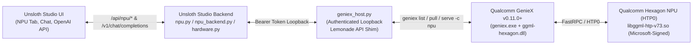

# Unsloth Studio — Qualcomm Hexagon NPU Bridge (Windows on Snapdragon)

Brings **Qualcomm Hexagon NPU (`HTP0`)** acceleration to **Unsloth Studio** on Windows 11 ARM64 Copilot+ PCs (`Snapdragon X`, `Snapdragon X Plus`, `Snapdragon X Elite`), mirroring Unsloth Studio's AMD Ryzen AI XDNA 2 NPU architecture.

## Highlights

- **Native Unsloth Studio NPU Tab Integration:** Unlocks Unsloth Studio's built-in **NPU** runtime tab, one-click model downloads, Load/Unload lifecycle (automatically freeing `llama-server` RAM on 16 GB devices), Chat, tool calling, reasoning controls, and OpenAI-compatible `/v1/chat/completions` endpoint.
- **No Windows `TESTSIGNING` Mode Required:** Uses **Qualcomm GenieX CLI (`Qualcomm.GenieX.CLI`)** which ships **Microsoft-signed** Windows ARM64 Hexagon HTP catalogs (`ggml-hexagon.dll` + `libggml-htp-v73.so` + `libggml-htp.cat`). Secure Boot, BitLocker, Smart App Control, and anti-cheat remain untouched.
- **Native Unsloth `Q4_0` GGUF Support:** Runs official `unsloth/*-GGUF:Q4_0` models from Hugging Face as well as local `Q4_0` GGUFs exported from Unsloth Studio directly on the Hexagon NPU (`~575–675 tok/s` prompt prefill, `~75–85 tok/s` decode on `Qwen3-0.6B-Q4_0` on Snapdragon X `X1-26-100`).
- **Live NPU Utilization Monitoring:** Wires Windows `DEVPKEY_GPU_LUID` (`cfgmgr32.dll`) + `pdh.dll` GPU Engine counters into Unsloth Studio's `npu_load_percent()` monitor in `<1 ms` with zero PowerShell subprocess overhead.
- **Idempotent & Reversible:** Keeps `.qualcomm_npu.bak` backups of all 6 patched Studio Python modules (`--apply`, `--status`, `--revert`).

---

## Architecture



---

## Quick Start (Windows 11 ARM64 / Snapdragon X)

### Prerequisites
- A Windows 11 ARM64 PC with a **Qualcomm Snapdragon X / X Plus / X Elite** processor and **Qualcomm Hexagon NPU**.
- **Unsloth Studio (Desktop)** installed (`%USERPROFILE%\.unsloth\studio`).

### Install & Apply

Run in PowerShell:

```powershell
.\install.ps1
```

Or manually:

```powershell
# 1. Install Qualcomm GenieX CLI (Microsoft-signed Hexagon HTP runtime)
winget install --id Qualcomm.GenieX.CLI --exact --accept-package-agreements --accept-source-agreements

# 2. Apply the Unsloth Studio backend bridge
& "$env:USERPROFILE\.unsloth\studio\unsloth_studio\Scripts\python.exe" .\apply_patch.py --apply

# 3. (Optional) Run the end-to-end verification test suite
& "$env:USERPROFILE\.unsloth\studio\unsloth_studio\Scripts\python.exe" .\test_bridge.py
```

Restart **Unsloth Studio**, open the **Model Hub / NPU** tab, click **Enable NPU**, and download/load any NPU model.

---

## Customizing the NPU Model Catalog

Edit `%USERPROFILE%\.unsloth\qualcomm-npu-bridge\models.json` to add any Hugging Face `<org>/<repo>:Q4_0` GGUF repository:

```json
{
  "checkpoint": "unsloth/Qwen3-4B-GGUF:Q4_0",
  "hf_repo": "unsloth/Qwen3-4B-NPU",
  "size_gb": 2.38,
  "max_context_window": 32768,
  "labels": ["chat", "reasoning", "tool-calling"]
}
```

Any model you pull directly via `geniex pull <repo>:Q4_0` in the terminal is also automatically discovered and listed in Unsloth Studio's NPU tab.

---

## Maintenance & Reverting

- **Check patch status:**
  ```powershell
  & "$env:USERPROFILE\.unsloth\studio\unsloth_studio\Scripts\python.exe" "$env:USERPROFILE\.unsloth\qualcomm-npu-bridge\apply_patch.py" --status
  ```
- **Re-apply after an Unsloth Studio update:**
  ```powershell
  & "$env:USERPROFILE\.unsloth\studio\unsloth_studio\Scripts\python.exe" "$env:USERPROFILE\.unsloth\qualcomm-npu-bridge\apply_patch.py" --apply
  ```
- **Revert to stock Unsloth Studio files:**
  ```powershell
  & "$env:USERPROFILE\.unsloth\studio\unsloth_studio\Scripts\python.exe" "$env:USERPROFILE\.unsloth\qualcomm-npu-bridge\apply_patch.py" --revert
  ```

## License

AGPL-3.0-only (matching Unsloth Studio).
