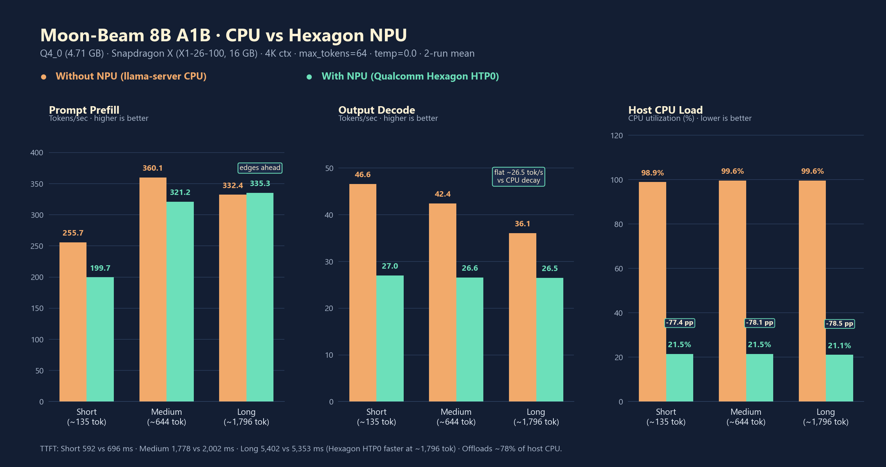
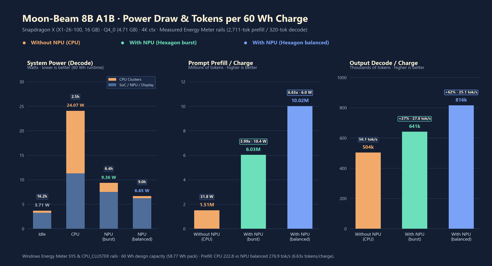
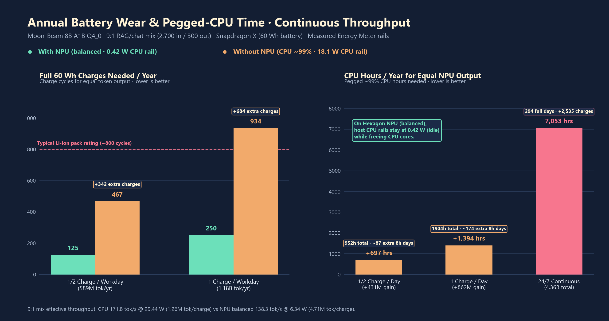
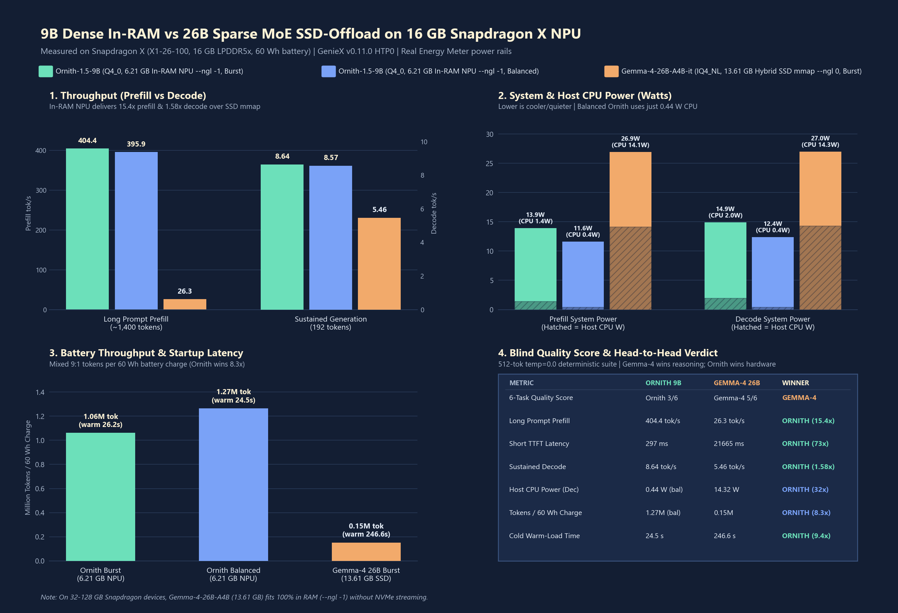
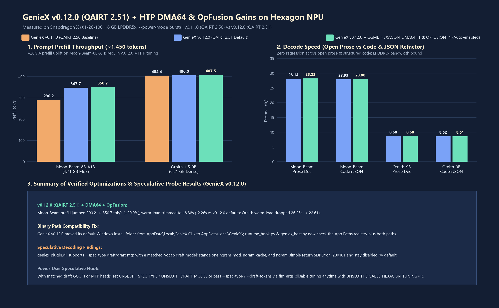
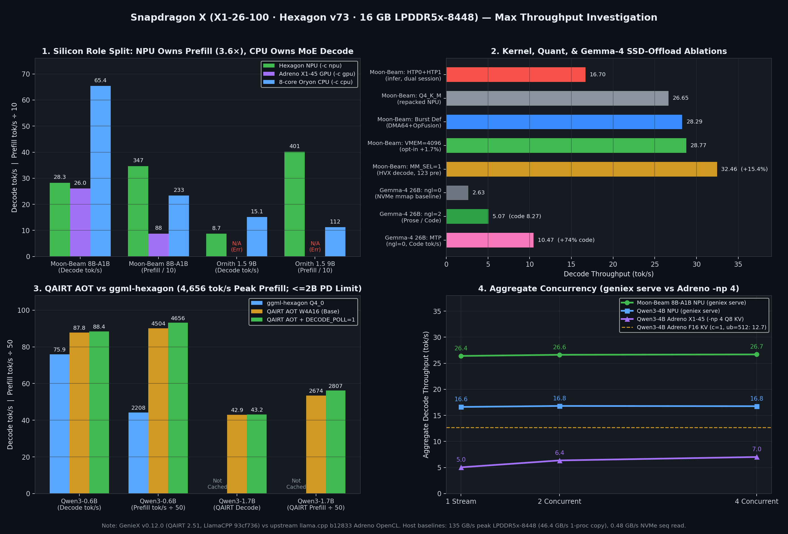
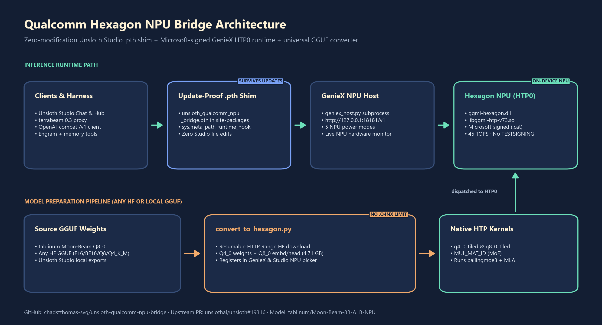
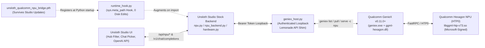

# Unsloth Studio — Qualcomm Hexagon NPU Bridge (Windows on Snapdragon)

Brings **Qualcomm Hexagon NPU (`HTP0`)** acceleration to **Unsloth Studio** on Windows 11 ARM64 Copilot+ PCs (`Snapdragon X`, `Snapdragon X Plus`, `Snapdragon X Elite`), mirroring Unsloth Studio's AMD Ryzen AI XDNA 2 NPU architecture.

> **Upstream Pull Request:** [`unslothai/unsloth#19316`](https://github.com/unslothai/unsloth/pull/19316) · **Flagship NPU Model Release:** [`tablinum/Moon-Beam-8B-A1B-NPU`](https://huggingface.co/tablinum/Moon-Beam-8B-A1B-NPU)


<details>
<summary>Annual Power-User Savings Breakdown (250 workdays/yr · 30 Wh/day battery budget · Measured Snapdragon X rails)</summary>

Assumes an AI power user spending **half a 60 Wh battery charge per workday (`30 Wh/day` × `250 workdays` = `7.50 kWh/yr`)** with a **9:1 RAG/coding/chat token mix (`2,700` input / `300` output)** on **`tablinum/Moon-Beam-8B-A1B-NPU:Q4_0`** (`4.71 GB`):

| Backend / Mode | Annual Tokens (`30 Wh/day`) | Multiplier vs CPU | Energy for Equal `589M` Tokens | Wall Power (`$0.17/kWh`) | Cloud Equivalent (`529.9M` in / `58.9M` out) |
| :--- | :---: | :---: | :---: | :---: | :--- |
| **Without NPU (CPU)** | `158M` | `1.00×` | `28.03 kWh` (`467` cycles) | `$4.76 / yr` | — |
| **With NPU (`burst`)** | `410M` | `2.60×` | `10.78 kWh` (`180` cycles) | `$1.83 / yr` | — |
| **With NPU (`balanced`)** | **`589M`** (**`+431M`**) | **`3.74×`** | **`7.50 kWh`** (**`-73.2%` · `342` fewer cycles**) | **`$1.27 / yr`** | Saves **`$239/yr`** vs `$20/mo` Pro · **`$764/yr`** vs `$1/$4` API · **`$2,472/yr`** vs `$3/$15` frontier API |

</details>

---

## Benchmarks: Before vs After (Qualcomm Hexagon NPU Bridge)

### Dense Model (`unsloth/Qwen3-0.6B-GGUF:Q4_0`)

Measured on a **Snapdragon X (`X1-26-100`, 45 TOPS Qualcomm Hexagon NPU, 16 GB LPDDR5x, Windows 11 ARM64 Build 26300)** running **`unsloth/Qwen3-0.6B-GGUF:Q4_0`** (same GGUF file, `4096` context, `max_tokens=96`, `temperature=0.0`, averaged over 3 uncached runs):


| Prompt Length | Before: Prefill (`llama-server` CPU) | After: Prefill (Hexagon NPU) | Before: TTFT | After: TTFT | Before: Host CPU | After: Host CPU | Before: Decode (CPU) | After: Decode (Hexagon NPU) |
| :--- | :---: | :---: | :---: | :---: | :---: | :---: | :---: | :---: |
| **Short (`~117 tok`)** | 1,356.4 tok/s | **1,674.7 tok/s** (`1.23×`) | 92 ms | **74 ms** (`1.24×` faster) | 99.6% | **35.2%** (`-64.4 pp`) | 127.9 tok/s | 72.4 tok/s |
| **Medium (`~630 tok`)** | 1,156.1 tok/s | **2,401.8 tok/s** (`2.08×`) | 555 ms | **260 ms** (`2.13×` faster) | 99.8% | **30.7%** (`-69.1 pp`) | 83.0 tok/s | 48.6 tok/s |
| **Long (`~1,780 tok`)** | 757.0 tok/s | **1,987.1 tok/s** (`2.62×`) | 2,376 ms | **894 ms** (`2.66×` faster) | 99.9% | **32.1%** (`-67.8 pp`) | 44.8 tok/s | 31.9 tok/s |

> **Why is 0.6B decode faster on CPU while prefill/TTFT & host CPU win big on NPU?**  
> On tiny `0.6B` weights (`~382 MB`), CPU decode is L2/SLC cache-resident and avoids DSP/HTP RPC synchronization overhead per token, whereas compute-bound prompt ingestion scales strongly on the Hexagon tensor cores (`2.08×–2.62×` faster prefill and `2.66×` lower Time-To-First-Token at `~1,780` tokens) while freeing **~68 percentage points of host CPU** so your laptop stays responsive and cool.

### 8B MoE Model ([`tablinum/Moon-Beam-8B-A1B-NPU`](https://huggingface.co/tablinum/Moon-Beam-8B-A1B-NPU) · `Q4_0`, 8B Total / 1B Active)

Measured on the same **Snapdragon X (`X1-26-100`, 16 GB)** running **`Moon-Beam-8B-A1B-Q4_0.gguf`** (`4.71 GB` converted cleanly with `convert_to_hexagon.py --quant Q4_0`) across speed, host CPU offload, and live Windows `\Energy Meter(SYS)` + `CPU_CLUSTER_0/1` power rails (`60 Wh` design / `58.77 Wh` full-charge battery):





<details>
<summary>Read Moon-Beam 8B A1B power & 60 Wh tokens-per-charge measurements as text (2,711-tok prefill / 320-tok decode)</summary>

| Mode | Prefill Speed & Power | Prefill / `60 Wh` Charge | Decode Speed & Power | Decode / `60 Wh` Charge | Continuous Runtime |
| :--- | :---: | :---: | :---: | :---: | :---: |
| **Idle Baseline** | — | — | `3.71 W` (`0.45 W` CPU) | — | `16.17 hrs` |
| **Without NPU (CPU)** | `222.8 tok/s` @ `31.81 W` (`20.46 W` CPU) | `1.51M` | `56.1 tok/s` @ `24.07 W` (`12.77 W` CPU) | `503.6k` | `1.89h` prefill · `2.49h` decode |
| **With NPU (`burst`)** | **`290.2 tok/s`** @ `10.39 W` (`3.02 W` CPU) | `6.03M` (**`3.99×`**) | `27.8 tok/s` @ `9.36 W` (`1.84 W` CPU) | `641.4k` (**`+27%`**) | `5.78h` prefill · `6.41h` decode |
| **With NPU (`balanced`)** | `276.9 tok/s` @ **`5.96 W`** (`0.43 W` CPU) | **`10.02M`** (**`6.63×`**) | `25.1 tok/s` @ **`6.65 W`** (`0.42 W` CPU) | **`816.1k`** (**`+62%`**) | **`10.06h`** prefill · **`9.02h`** decode |

</details>



<details>
<summary>Read the annual battery-cycle &amp; pegged-CPU time breakdown (9:1 continuous battery throughput)</summary>

| Continuous Battery Scenario (`60 Wh` pack, 9:1 mix) | NPU (`balanced`) Output | CPU Output (Same Charges) | NPU Token Gain | Extra 60 Wh Charges CPU Needs for That Gain | Extra Pegged-CPU Time (`~99%` CPU / `18.1 W`) |
| :--- | :---: | :---: | :---: | :---: | :---: |
| **1/2 Charge / Workday** (`125` charges/yr) | `588.8M` tok | `157.5M` tok | `+431.2M` tok | **`+342` extra charges** (`467` total) | **`+697` hrs/yr** (`952h` total · `~87` extra `8h` days) |
| **1 Charge / Workday** (`250` charges/yr) | `1.18B` tok | `315.1M` tok | `+862.4M` tok | **`+684` extra charges** (`934` total) | **`+1,394` hrs/yr** (`1,904h` total · `~174` extra `8h` days) |
| **24/7/365 Continuous** (`8,760 hrs/yr` on NPU) | `4.36B` tok (`926` charges) | — *(equal-token CPU match)* | — | **`+2,535` extra charges** (`3,461` total · `9.5`/day) | **`7,053` hrs/yr** (`294` full `24h` days at `~99%` CPU) |

</details>

### 9B Dense In-RAM (`Ornith-1.5-9B-NPU`) vs 26B Sparse MoE Hybrid NPU + SSD Offload (`Gemma-4-26B-A4B-it-NPU`)

Testing whether a **26B Sparse MoE (`4B` active, `13.61 GB` `UD-IQ4_NL`, `hybrid_npu_ssd` via read-only NVMe `mmap`)** beats a **9B Dense model (`6.21 GB` `Q4_0`, 100% `in_ram_npu --ngl -1`)** on a **16 GB Snapdragon X (`X1-26-100`)**:



<details>
<summary>Read the full 6-dimension head-to-head numbers (live Energy Meter rails · 512-tok temp=0.0 blind quality suite)</summary>

Idle baseline before test: `8.17 W` (`1.58 W` CPU). All runs use `4096` context, `temperature=0.0`, and `think=false` (`GGML_HEXAGON_RT_REPACK=0`, `LLAMA_ARG_REPACK=0` for `Gemma-4-26B`).

| Model & Tier | Warm-Load | Short Prefill (~40 tok) | Long Prefill (~1.4K tok) | Sustained Decode (192 tok) | 60 Wh `9:1` Mixed Tokens/Charge | 6-Task Blind Quality |
| :--- | :---: | :---: | :---: | :---: | :---: | :---: |
| **`Ornith-1.5-9B-NPU:Q4_0`** (`6.21 GB`, `in_ram_npu --ngl -1`, `burst`) | `26.25 s` | **`151.5 tok/s`** (`297 ms`) @ `9.50 W` | **`404.4 tok/s`** (`3,585 ms`) @ `13.93 W` (`1.42 W` CPU) | **`8.64 tok/s`** @ `14.91 W` (`1.97 W` CPU) | `1.06M` | `3 / 6` |
| **`Ornith-1.5-9B-NPU:Q4_0`** (`6.21 GB`, `in_ram_npu --ngl -1`, `balanced`) | **`24.50 s`** | `146.2 tok/s` (`308 ms`) @ **`9.35 W`** | `395.9 tok/s` (`3,663 ms`) @ **`11.62 W`** (**`0.40 W` CPU**) | `8.57 tok/s` @ **`12.37 W`** (**`0.44 W` CPU**) | **`1.27M`** (**`8.3×`**) | — |
| **`Gemma-4-26B-A4B-it-NPU:IQ4_NL`** (`13.61 GB`, `hybrid_npu_ssd -c npu --ngl 0`, `burst`) | `246.64 s` | `2.33 tok/s` (`21,665 ms`) @ `18.37 W` | `26.32 tok/s` (`55,027 ms`) @ `26.94 W` (`14.15 W` CPU) | `5.46 tok/s` @ `26.98 W` (`14.32 W` CPU) | `0.15M` | **`5 / 6`** (`q3_logic` fail) |

*(Note: `Gemma-4-26B` `balanced` mode warm-loaded in `388.64s` and timed out during generation; pinning `--ngl 22` / `--ngl 11` on `15.61 GB` physical RAM triggers paging thrashing, so the shim automatically steps down to `-c npu --ngl 0 --power-mode burst` when live free RAM is under `10.5 GB`.)*

</details>

**Takeaway:** `Gemma-4-26B-A4B-it` wins single-shot reasoning quality (**`5/6` vs `3/6`**), so Gemma-4 does **not** win on all accounts on a **16 GB** Snapdragon X: once a `13.61 GB` MoE exceeds usable RAM (`10.15 GB`) and streams weights from NVMe SSD, **`Ornith-1.5-9B-NPU` (`6.21 GB` in-RAM) beats it across every hardware & UX metric** — **`9.4×` faster startup**, **`73×` lower short TTFT**, **`15.4×` faster long prefill**, **`1.58×` faster decode**, **`32×` lower host CPU draw (`0.44 W`)**, and **`8.3×` more tokens per `60 Wh` charge**. Meanwhile on **`32–128 GB` Snapdragon hosts**, the same `plan_model_execution()` engine runs `26B–35B` MoEs 100% in-RAM (`--ngl -1`).

### GenieX `v0.12.0` (`QAIRT 2.51`) + `GGML_HEXAGON_DMA64` / `OPFUSION` Tuning

Upgrading to **Qualcomm GenieX CLI `v0.12.0`** (`QAIRT 2.51`) plus automatically enabling **`GGML_HEXAGON_DMA64=1`** and **`GGML_HEXAGON_OPFUSION=1`** on `in_ram_npu` models yields immediate MoE prefill & warm-load gains with zero decode regression:



<details>
<summary>Read the v0.11.0 vs v0.12.0 + HTP Tuning & Speculative Probe numbers (`--power-mode burst`, 4096 ctx)</summary>

| Model | Configuration | Warm-Load | Long Prefill (`~1.4K` tok) | Open Prose Decode (`192` tok) | Code + JSON Refactor Decode (`220` tok) |
| :--- | :--- | :---: | :---: | :---: | :---: |
| **`Moon-Beam-8B-A1B-NPU:Q4_0`** | `v0.11.0` (`QAIRT 2.50`) | — | `290.16 tok/s` | `27.80 tok/s` | — |
| **`Moon-Beam-8B-A1B-NPU:Q4_0`** | `v0.12.0` (`QAIRT 2.51`) Default | `20.64 s` | `347.68 tok/s` (`+19.8%`) | `28.14 tok/s` | `27.93 tok/s` |
| **`Moon-Beam-8B-A1B-NPU:Q4_0`** | **`v0.12.0` + `DMA64=1` & `OPFUSION=1`** | **`18.38 s`** (`-2.26 s`) | **`350.72 tok/s`** (**`+20.9%`**) | **`28.23 tok/s`** | **`28.00 tok/s`** |
| **`Ornith-1.5-9B-NPU:Q4_0`** | `v0.11.0` (`QAIRT 2.50`) | `26.25 s` | `404.42 tok/s` | `8.64 tok/s` | — |
| **`Ornith-1.5-9B-NPU:Q4_0`** | `v0.12.0` (`QAIRT 2.51`) Default | **`22.51 s`** (`-3.74 s`) | `406.01 tok/s` | **`8.68 tok/s`** | **`8.62 tok/s`** |
| **`Ornith-1.5-9B-NPU:Q4_0`** | **`v0.12.0` + `DMA64=1` & `OPFUSION=1`** | `22.61 s` | **`407.51 tok/s`** | **`8.68 tok/s`** | `8.61 tok/s` |

- **Zero-RAM Speculative Decoding (`--spec-type`):** Standard transformers (`Qwen3-0.6B/4B`) support all `ngram-*` modes (`Qwen3-0.6B` hits **`126.8 tok/s`** at `93%` acceptance with `ngram-cache`, `Qwen3-4B` hits **`17.48 tok/s`** with `ngram-mod`), whereas hybrid SSM models (`Moon-Beam`, `Ornith`) fail batch rollback under `ngram-cache` (`SDKError -200101`) unless using `--spec-type ngram-mod --draft-min 1`. Power users can set `UNSLOTH_SPEC_TYPE` / `UNSLOTH_DRAFT_MODEL` / `UNSLOTH_DRAFT_TOKENS` / `UNSLOTH_DRAFT_MIN` or pass `--spec-type` / `--draft-tokens` via `flm_args` (or `UNSLOTH_DISABLE_HEXAGON_TUNING=1` to opt out).

</details>

### Silicon Roofline & Max-Throughput Investigation (`Snapdragon X X1-26-100` · Hexagon `v73`)

Systematic 6-phase audit across all 29 `ggml-hexagon.dll` environment knobs, multi-session `HTP0,HTP1`, Adreno `X1-45` OpenCL, 8-core Oryon CPU, speculative decoding, QAIRT ahead-of-time (`W4A16`) context binaries, and `llama.cpp b12833` concurrency on this `16 GB` `LPDDR5x-8448` (`135 GB/s` peak) system (`NVMe FSB0C256G-F9Y0900` `0.48 GB/s` unbuffered sequential read):



<details>
<summary>Key Findings & Measured Tuning Matrix (Wired Safely Into Bridge)</summary>

1. **Silicon Role Split (NPU Owns Prefill; CPU Owns MoE Decode):**
   - On **`Ornith-1.5-9B-NPU:Q4_0` (`qwen35`)**, Hexagon NPU (`4746 MiB` `HTP0` + `1031 MiB` `HTP0-HOST`, `1435 MHz`, `0` CPU fallbacks) hits **`401.3 tok/s`** prefill (**`3.6×` faster** than Oryon CPU `112.4 tok/s`), while 8-core Oryon CPU decodes faster single-stream (`15.10 tok/s` vs `8.69 tok/s` NPU, as `M=1` `hvx-tiled` uses ~`54 GB/s` vs CPU ~`94 GB/s`).
   - On **`Moon-Beam-8B-A1B-NPU:Q4_0` (`bailingmoe3`)**, NPU dominates prefill (**`346.7 tok/s`** vs `233.3` CPU / `87.8` Adreno GPU) and runs sparse MoE experts on-chip (`50.3%` in `MUL_MAT_ID(_NX)`), while `-c cpu` (`UNSLOTH_COMPUTE=cpu` opt-in) hits **`65.41 tok/s`** prose / `57.55` code decode via full DDR/cache residency, and Adreno `X1-45` (`ADRENO_XMEM_GEMM=1` + `FUSE_MOE_COMBINE=1`) hits `26.03 / 26.49 tok/s`.
2. **Hexagon Kernel, `VMEM`, & Dual-Session Knobs:**
   - **Auto-wired `GENIEX_DECODE_POLL=1` for QAIRT AOT (`<=2B`):** Comparing `qualcomm/Qwen3-0.6B` (`QAIRT W4A16`) vs `unsloth/Qwen3-0.6B-GGUF:Q4_0` (`llama_cpp`), QAIRT AOT reached **`4,655.9 tok/s`** prefill (**`2.1×` faster** than `2,208.4` `ggml-hexagon`) and **`88.17 tok/s`** decode (`88.39` with `GENIEX_CLOCK_KEEPER_THREADS=1`, vs `75.94` `ggml-hexagon`). On `qualcomm/Qwen3-1.7B`, `GENIEX_DECODE_POLL=1` lifted both prefill (`2,673.9 -> 2,807.0 tok/s`) and decode (`42.93 -> 43.17` / `43.23`). Larger QAIRT bundles (`qualcomm/Qwen3-4B`) hit a FastRPC PD mapping limit (`0x200` / `QNN err 1002` at `1.99 GB`), so the bridge tags QAIRT models as `*-QAIRT-NPU` without colliding with `ggml-hexagon` GGUFs and omits `--nctx`/`--ngl` automatically.
   - **Auto-wired Mid-RAM `ngl=2` for Hybrid SSD Offload (`4.5–10.5 GB` live free RAM):** On `Gemma-4-26B-A4B-it-NPU:IQ4_NL` (`13.61 GB`, `2048` ctx), bumping `ngl=0 -> ngl=2` nearly doubled prose decode (**`2.63 -> 5.07 tok/s`**, **`+93%`**), lifted code decode (**`6.02 -> 8.27 tok/s`**, **`+37%`**), and raised prefill (`25.26 -> 29.22 tok/s`) in `84.5s` warm load (`ngl=4` hit `6.13` prose in `123s`, `hybrid ngl=0` hit `8.25` prose in `146s`, and `ngl=0` + cached `--spec-type draft-mtp` hit **`10.47 tok/s` code**).
   - **Opt-In Power-User Flags (NOT wired globally due to tradeoffs):**
     - `GGML_HEXAGON_MM_SELECT=1`: boosts `Moon-Beam` decode **`+13.3%`** (`28.64 -> 32.46 tok/s`) by selecting HVX kernels, but cuts prefill `346 -> 123 tok/s` and stalls dense `Ornith` prefill.
     - `GGML_HEXAGON_VMEM=4096`: boosts `Moon-Beam` decode to `28.77 tok/s`, but hangs `unsloth/Qwen3-4B-GGUF:Q4_0` at load (while `VMEM=4608`/`6144` fail load).
     - `HTP0,HTP1` dual virtual sessions: regresses `Moon-Beam` to `16.7 tok/s` (`infer`) and fails `Ornith` load (`-100201`) because `X1-26-100` has a single physical CDSP core (`phys=0`). `--power-mode burst` beats `sustained_high_performance` (`26.35`) and `high_performance` (`26.30`) even on 512-token runs.
3. **Concurrency (`geniex serve` vs Upstream `llama.cpp b12833` Adreno OpenCL):**
   - `geniex serve` (`n_seq_max=1`) holds steady aggregate throughput (`Qwen3-4B`: `16.62 / 16.81 / 16.76 tok/s`, `Moon-Beam`: `26.40 / 26.62 / 26.69 tok/s` across `c=1,2,4`), outperforming upstream `llama-server b12833` on `Adreno X1-45` OpenCL (`Qwen3-4B` `ub=512 F16`: `12.97 tok/s` decode / `124.85 tok/s` prefill; `-np 4` with `-ctk q8_0 -ctv q8_0` scales `5.04 -> 6.36 -> 7.02 tok/s`).

</details>

---

## Highlights

- **Update-Proof Zero-Modification `.pth` Runtime Shim:** Installs a single tiny `unsloth_qualcomm_npu_bridge.pth` hook in `Lib\site-packages\` pointing to `~/.unsloth/qualcomm-npu-bridge/runtime_hook.py` (`sys.meta_path` import interceptor). All Unsloth Studio source files stay **100% stock on disk**, so in-place Studio updates (`uv pip install --upgrade unsloth`) **never overwrite or break the shim**. If upstream PR [`unslothai/unsloth#19316`](https://github.com/unslothai/unsloth/pull/19316) is merged in a future release, the hook automatically steps aside as a no-op.
- **No Windows `TESTSIGNING` Mode Required:** Uses **Qualcomm GenieX CLI (`Qualcomm.GenieX.CLI`)** which bundles Microsoft/Qualcomm Authenticode-signed Hexagon HTP runtime catalogs (`libggml-htp.cat`, `libqnnhtpv73.cat`, `QnnHtp.dll`), keeping Secure Boot, BitLocker, and `TESTSIGNING` untouched. *(Note: `v0.11.0`'s CLI host `geniex.exe` / `geniex.dll` itself is not yet Authenticode-signed; if Windows Smart App Control moves from Evaluation to Enforced mode and returns `0xC0E90002`, the shim surfaces that exact block message.)*
- **Universal `8–128 GB` Auto-Scaling & Hybrid NPU + Read-Only NVMe SSD `mmap` Offload (`0 TBW`):** Automatically selects `in_ram_npu` vs `hybrid_npu_ssd` (`GGML_HEXAGON_RT_REPACK=0`, `LLAMA_ARG_REPACK=0`) so 16 GB Snapdragon laptops can stream inactive `24B–35B` MoE experts from NVMe via read-only OS page-cache `mmap` while pinning shared layers and Multi-Token Prediction (`MTP`, `--spec-type draft-mtp`) draft heads in RAM/Hexagon `HTP0`.
- **Live-RAM Context Clamping & Self-Healing Auto-Respawn:** Dynamically clamps `--nctx` (`4096 / 8192 / 16384+`) against live `avail_ram_gb` headroom (stopping any prior child before probing), caches `/v1/models` & Studio export scans (`5s`/`15s` TTL), dynamically queries `geniex.exe --version`, and automatically respawns `geniex.exe` at stepped-down context if a child exits mid-session.
- **Native Unsloth `Q4_0` GGUF & 26-Model Curated Catalog (`models.json`):** Runs `Moon-Beam-8B-A1B`, `Ornith-1.5-9B / 35B-A3B`, `Gemma-4 (E2B / E4B / 12B / 26B-A4B)`, `Qwen3 / 3.5 / 3.6`, `LFM2.5-24B-A2B`, `Granite-4.2`, `Phi-4-mini`, and `Llama-3.2` with `--hf-mtp-file` draft-head staging, tool calling, and reasoning controls.
- **Live NPU Utilization Monitoring:** Wires Windows `DEVPKEY_GPU_LUID` (`cfgmgr32.dll`) + `pdh.dll` GPU Engine counters into Unsloth Studio's `npu_load_percent()` monitor in `<1 ms` with zero PowerShell subprocess overhead.
- **Cleanly Reversible:** Remove anytime via `--revert` or by deleting `unsloth_qualcomm_npu_bridge.pth`.

---

## Architecture





---

## Quick Start (Windows 11 ARM64 / Snapdragon X)

### Prerequisites
- A Windows 11 ARM64 PC with a **Qualcomm Snapdragon X / X Plus / X Elite** processor and **Qualcomm Hexagon NPU**.
- **Unsloth Studio (Desktop)** installed (`%USERPROFILE%\.unsloth\studio`).

### Install

Run in PowerShell:

```powershell
.\install.ps1
```

Or manually:

```powershell
# 1. Install Qualcomm GenieX CLI (Microsoft-signed Hexagon HTP runtime)
winget install --id Qualcomm.GenieX.CLI --exact --accept-package-agreements --accept-source-agreements

# 2. Install the update-proof .pth runtime shim & sync files to %USERPROFILE%\.unsloth\qualcomm-npu-bridge
& "$env:USERPROFILE\.unsloth\studio\unsloth_studio\Scripts\python.exe" .\apply_patch.py --apply

# 3. (Optional) Run the end-to-end verification test suite
& "$env:USERPROFILE\.unsloth\studio\unsloth_studio\Scripts\python.exe" .\test_bridge.py
```

Restart **Unsloth Studio** (quit completely from the system tray and reopen).

---

## Where to Find NPU in Unsloth Studio's UI

Unsloth Studio surfaces NPU controls inside existing views (rather than a separate sidebar tab):

1. **Model Hub (`Hub`) → Format Filter Dropdown → `NPU`:** Next to `Recommended`, `GGUF`, `Safetensors`, `MLX`, and `Fine-tune ready`, select **`NPU`** to enable the runtime and download curated Hexagon NPU models (`unsloth/Qwen3-0.6B-NPU`, `Llama-3.2`, `gemma-3`, etc.).
2. **Chat → Model Picker → `NPU` Filter Pill / Section:** Click the model selector in the Chat composer, choose the **`NPU`** format pill (`All | GGUF | MLX | Safetensors | NPU`) or scroll to the **`NPU`** section, and pick your downloaded model.
3. **Chat Settings & Hardware Monitor:** When an NPU model is active, Chat Settings exposes **Power Mode** (`Power saver` / `Balanced` / `Performance` / `Turbo`), and the Hardware Monitor shows live **Qualcomm Hexagon NPU** utilization.

---

## Customizing the NPU Model Catalog & Local GGUF Converter

### Add Any Hugging Face / Local Model (`convert_to_hexagon.py`)

Qualcomm GenieX's `ggml-hexagon` backend accelerates standard `Q4_0`, `Q8_0`, `Q4_K_M`, `Q5_K_M`, `Q6_K`, `IQ4_NL`, and `MXFP4` GGUFs directly on Hexagon `HTP0` without AMD's `.q4nx` shape allowlist. Use [convert_to_hexagon.py](convert_to_hexagon.py) to convert any local or Hugging Face GGUF to Hexagon-native `Q4_0` (with `Q8_0` output/embedding tensors) and register it in GenieX + Unsloth Studio:

```powershell
# Convert a Hugging Face model (resumable download + Q4_0 conversion + GenieX registration)
& "$env:USERPROFILE\.unsloth\studio\unsloth_studio\Scripts\python.exe" .\convert_to_hexagon.py `
  --hf-repo tablinum/Moon-Beam-8B-A1B-GGUF `
  --hf-file Moon-Beam-8B-A1B-Q4_K_M.gguf `
  --quant Q4_0 --also-register-source

# Register an SSD-offloaded MoE model alongside its MTP speculative draft head
& "$env:USERPROFILE\.unsloth\studio\unsloth_studio\Scripts\python.exe" .\convert_to_hexagon.py `
  --hf-repo unsloth/gemma-4-26B-A4B-it-GGUF `
  --hf-file gemma-4-26B-A4B-it-UD-IQ4_NL.gguf `
  --hf-mtp-file MTP/mtp-gemma-4-26B-A4B-it-Q8_0.gguf `
  --name unsloth/gemma-4-26B-A4B-it-NPU --no-convert

# Convert any local GGUF file (F16 / BF16 / Q4_K_M / IQ3_XXS / Studio export)
& "$env:USERPROFILE\.unsloth\studio\unsloth_studio\Scripts\python.exe" .\convert_to_hexagon.py C:\path\to\model.gguf --quant Q4_0

# Auto-discover & register all GGUF exports in %USERPROFILE%\.unsloth\studio\exports\
& "$env:USERPROFILE\.unsloth\studio\unsloth_studio\Scripts\python.exe" .\convert_to_hexagon.py --scan-exports --auto-quantize
```

All Hexagon-ready GGUFs exported under `%USERPROFILE%\.unsloth\studio\exports\` are also **auto-discovered** via zero-copy NTFS hardlinks whenever Unsloth Studio refreshes the NPU catalog.

Verified `tablinum/Moon-Beam-8B-A1B-GGUF` (`8B total / 1B active` `bailingmoe3` MoE, 4K context) throughput on Snapdragon X (`X1-26-100` Hexagon `HTP0`):

| Precision | Size on Disk | Prefill Speed | Decode Speed | Reasoning & Tool Calling |
| :--- | :---: | :---: | :---: | :--- |
| **`Q4_0` (Converted via `convert_to_hexagon.py`)** | `4.71 GB` | **111.2 – 131.4 tok/s** | **27.3 – 27.9 tok/s** | `think=on/off` verified |
| **`Q4_K_M`** | `4.94 GB` | **103.3 – 123.1 tok/s** | **26.0 – 26.3 tok/s** | `think=on/off` verified |

### Curated Catalog (`models.json` — 26 Presets)

Edit `%USERPROFILE%\.unsloth\qualcomm-npu-bridge\models.json` to add any Hugging Face `<org>/<repo>:Q4_0` GGUF repository:

```json
{
  "checkpoint": "unsloth/Qwen3-4B-GGUF:Q4_0",
  "hf_repo": "unsloth/Qwen3-4B-NPU",
  "size_gb": 2.38,
  "max_context_window": 32768,
  "labels": ["chat", "reasoning", "tool-calling"]
}
```

Any model you pull directly via `geniex pull <repo>:Q4_0` in the terminal is also automatically discovered and listed in Unsloth Studio's NPU catalog.

---

## Maintenance & Reverting

- **Check shim status & verify Studio files are clean stock:**
  ```powershell
  & "$env:USERPROFILE\.unsloth\studio\unsloth_studio\Scripts\python.exe" "$env:USERPROFILE\.unsloth\qualcomm-npu-bridge\apply_patch.py" --status
  ```
- **Temporarily disable for a single session without removing:** Set `UNSLOTH_QUALCOMM_NPU_DISABLE=1` in the environment.
- **Reinstall if you recreate the Unsloth Studio virtualenv from scratch:**
  ```powershell
  & "$env:USERPROFILE\.unsloth\studio\unsloth_studio\Scripts\python.exe" "$env:USERPROFILE\.unsloth\qualcomm-npu-bridge\apply_patch.py" --apply
  ```
- **Remove the shim cleanly (or delete `Lib\site-packages\unsloth_qualcomm_npu_bridge.pth`):**
  ```powershell
  & "$env:USERPROFILE\.unsloth\studio\unsloth_studio\Scripts\python.exe" "$env:USERPROFILE\.unsloth\qualcomm-npu-bridge\apply_patch.py" --revert
  ```

## License

AGPL-3.0-only (matching Unsloth Studio).
